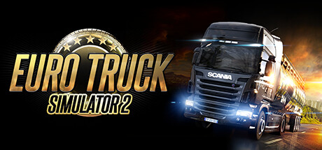

**Euro Truck Simulator 2 is the supremely relaxing long-haul trucking simulator where you build a fleet business delivering cargo across a faithfully rendered Europe. Features an enormous map, hundreds of trucks from real manufacturers, and incredibly calming gameplay.**

---

## 📖 About

Euro Truck Simulator 2 is the supremely relaxing long-haul trucking simulator where you build a fleet business delivering cargo across a faithfully rendered Europe. Features an enormous map, hundreds of trucks from real manufacturers, and incredibly calming gameplay.

## ⚠️ Problems Without Trainer

| Problem | Status |
|---------|--------|
| **Manual Transmission** — Players preferring manual gears must master complex truck shifting sequences | ✅ Solved |
| **Driver Fatigue** — Ignoring mandatory rest stops results in fines and impaired visibility | ✅ Solved |
| **Skill Point Allocation** — Spending skill points on wrong trucking specializations limits earnings | ✅ Solved |
| **Heavy Cargo DLC** — Special transport permits and escort missions require specific upgrade investment | ✅ Solved |

## ✅ Solution

The **Euro Truck Simulator 2 Trainer** solves all these issues by giving you complete control over the game.

## 🎯 Full Feature List

- Unlimited Resources
- God Mode / Invincibility
- Instant Skill Cooldown
- One-Hit Kill
- Freeze Game Timer
- Unlock All Items & Achievements
- Custom Speed Multiplier
- Save State Anywhere

## 🚀 Quick Start

1. **Disable Windows Defender** temporarily (trainer may trigger false positive)
2. Download the trainer from the button above
3. Launch Euro Truck Simulator 2
4. Run the trainer as Administrator
5. Activate desired cheats with hotkeys

## 💎 Free vs Paid

| Feature | Free | Pro |
|---------|------|-----|
| Basic God Mode | ✅ | ✅ |
| Unlimited Resources | ✅ | ✅ |
| All Advanced Cheats | ❌ | ✅ |
| Auto-Updates | ❌ | ✅ |
| Priority Support | ❌ | ✅ |

## 💻 Requirements

- Windows 10/11 (64-bit)
- Euro Truck Simulator 2 (any version)
- .NET Framework 4.8+
- DirectX 11+

## 🍎 macOS

macOS users can use our alternative tool:

## ⚖️ Legal

This trainer is for educational and single-player use only. Use responsibly.

---

